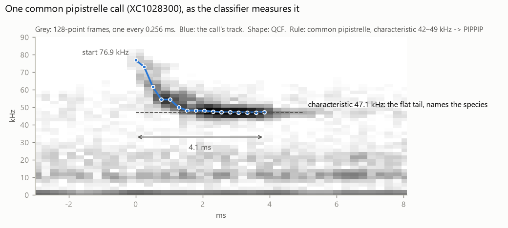
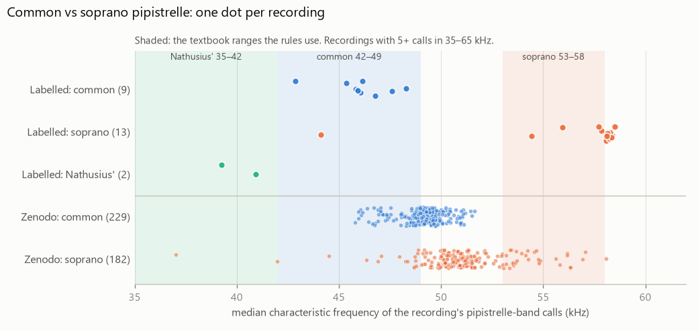
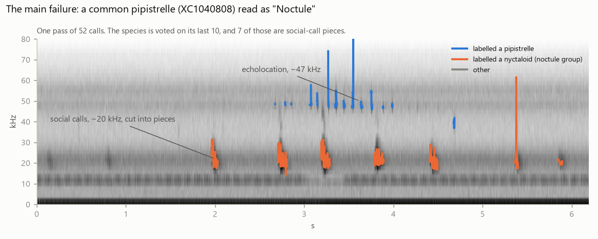

# Bat species classifier: findings so far (Nov 4)

The classifier was written as a PC model (`Tools/classify.py`, `Tools/species.py`), and that is what this page tested. Since then (Nov 4) it has been ported to the board, matching the model call for call on these recordings (diary 51); it hasn't run on the board yet. This page covers how it works, how well it does on real recordings, and the options for what's next.

## How it works

It looks at one call at a time, then at the pass as a whole.

1. **Frames.** It takes a 128-point FFT every 0.256 ms: 1.95 kHz bins covering 10–119 kHz. Each bin is compared with its own noise floor, so a steady tone disappears. The frame's peak is the bin furthest above its floor. A frame that is loud across most of the band (a finger rub, cloth) can't be part of a call.
2. **Calls.** A call starts when 2 frames in a row are 12 dB above the noise. It ends after 3 weak frames.
   - Calls only sweep down or hold, so a jump **up** of more than 8 kHz starts a new call.
   - In a call, the peak can't fall more than 16 kHz from one frame to the next, so the track can't jump to another sound.
3. **Measurements** per call: duration; start, end and peak frequency; slopes; flatness; and the **characteristic frequency**, the end of the call's flattest part. That last one is what tells most species apart.
4. **Shape:**
   - CF: long and constant (horseshoe bats);
   - QCF: a sweep into a flat tail (pipistrelles, noctules, serotines);
   - steep FM: a fast, wide sweep (Myotis);
   - faint FM: a short, quiet sweep (long-eared bats, barbastelle);
   - rising calls aren't echolocation, and are ignored.
5. **Species rules.** Within its shape, each call is matched against frequency and duration ranges from the European call tables.
   - If two species fit almost equally well, the call counts for the group they share.
   - If none fits, it counts for the group its frequency band belongs to.
6. **The pass.** Calls less than 1 s apart make a pass. The **last 10 calls vote**: a species needs 60% of the vote and 5 calls, otherwise the answer is its group or "Bat sp.". Echoes don't vote.



Some species can't be told apart by these measurements, by design:
- most Myotis come out as "Myotis sp.";
- serotine, Leisler's and noctule overlap, so they often come out as "Nyctaloid group".

On the device, the plan is to run this after each pass, reading the pass back from the PSRAM ring in the main loop. That takes about 4.5 KB of RAM; 6.8 KB is free. Details are in `Docs/CLASSIFIER_PLAN.md`.

## What was tested

| Data | What it is | What it can show |
|---|---|---|
| 13 bench signals | Synthetic calls and rubs in noise the board recorded on top of the PC | Each stage does what it should. All pass. Says nothing about outdoor noise: the PC adds energy around 20–25 kHz that isn't there outside. |
| Zenodo 3247097 | 444 recordings of common and soprano pipistrelles, 1,002 s | Calls found, and false alarms. Its species labels are doubtful (below). |
| xeno-canto + Biodiversity Ireland | 40 recordings of 11 species, labelled by experts | Species verdicts |

## Findings

**1. It finds bat calls, but it also picks up other sounds.**
- On Zenodo, where every call's position is known, it finds 96% of the calls.
- On the bench, the synthetic finger rubs gave ~8,000 false calls a minute before the rub filter; now they give at most one stray call, and never a reported bat. Real rubs and typing haven't been tested yet.
- Field recordings hold other sounds too. These are the downloaded recordings, not the board's. In the stretches Zenodo marks as silent, it detects ~820 "calls" a minute:
  - mostly at 10–20 kHz, a median 18 dB above the floor: insects or recorder noise, not the detection threshold;
  - about 1 in 8 look like faint pipistrelles that the dataset missed.
- These detections are what pull verdicts to "Bat sp." or the wrong group (point 4).

**2. Frequencies are measured well enough to tell common from soprano.** On the labelled recordings:
- common pipistrelles sit at 42.9–48.3 kHz;
- sopranos sit at 54.4–58.5 kHz, inside the textbook ranges the rules use;
- the one exception, at 44 kHz, is XC1031661: 67 s of mostly insect noise, with only 11 calls in the band.

The Zenodo "sopranos" mostly sit at 50–52 kHz, where no textbook puts them, so it's that dataset's labels that are in doubt, not the method.



**3. Verdicts on the 40 labelled recordings:**

| Species | Files | Right | Group | Bat sp. | Wrong |
|---|---|---|---|---|---|
| Common pipistrelle | 9 | 4 | 2 | 1 | 2 |
| Soprano pipistrelle | 15 | 5 | 1 | 5 | 4 |
| Nathusius' pipistrelle | 2 | 1 | | 1 | |
| Noctule | 2 | 1 | | 1 | |
| Serotine | 6 | | 5 | 1 | |
| Leisler's | 1 | | 1 | | |
| Lesser horseshoe | 1 | 1 | | | |
| Myotis (3 species) | 3 | | | 1 | 2 |
| Brown long-eared | 1 | | | | 1 |
| **All** | **40** | **12** | **9** | **10** | **9** |

- For serotine and Leisler's, "Group" (Nyctaloid group) is the intended answer.
- On Zenodo, common pipistrelle is named in 41% of recordings, with 1% wrong species. Its sopranos are 10% right and 15% wrong, almost all of them named common.

**4. Why it goes wrong.** In order of how often:
- **Sound at 10–35 kHz that isn't echolocation.** This decides about 12 of the 40 files. All of it is in the outdoor recordings themselves; none comes from the board.
  - Pipistrelle social calls (~20 kHz, 30–60 ms, several parts) get cut into short pieces that look like noctule calls.
  - Insects make the same kind of error, notably an 11 kHz chirp that recurs in several files.
  - Because only the last 10 calls vote, a pass that ends on such sounds is named after them.
- **A second bat.** The last 10 calls can belong to the other bat.
- **Myotis.** Daubenton's echoes off water give its sweeps flat tails, and the rub filter drops 155 detections in the Natterer's recording. There is one recording per species, and those verdicts change with small details.



**5. Changed today:** a call's track now stays on its own frequency. Before, the lesser horseshoe's 108 kHz calls hopped to their 54 kHz fundamental, and soprano calls dropped to an insect at 11 kHz. Now the horseshoe is named, and the Zenodo common pipistrelles went from 37% to 41% right.

**Tried and dropped,** each because it made the verdicts worse or changed nothing:
- learning the noise floor during calls;
- ignoring low calls that fit no species;
- voting on the whole pass instead of the last 10 calls (serotines became noctules).

## Caveats

- These are 40 recordings, with one per species for most non-pipistrelles. 12 right out of 40 is consistent with a true rate anywhere from about 18% to 45% (95% interval).
- They were made on dedicated bat detectors. **This board's microphone is rated to ~80 kHz.** Lesser horseshoes (105–112 kHz) may be too faint to classify on the device.
- Nothing has been run on recordings from this detector yet. Bats are hibernating until about April.

## Options

1. **Stop here.** You keep a PC tool that labels your recorder's WAVs (`python -I Tools/classify.py D:\BAT00001.WAV`).
2. **More PC work first.**
   - Keep social calls out of the vote: a burst of pieces at 15–30 kHz within ~60 ms counts as one social call. This targets the biggest error, the ~12 files. It's a small change, but it's tuned on 40 downloaded files.
   - Let a pass name two bats.
3. **Step 1 on the device.**
   - Stages 1–3 run after each pass, reading the ring, with a per-call CSV log on the SD card.
   - It's checked against `classify.py` on the same WAV, and can be tested on the bench now with the 40 kHz sensor.
   - It's needed whatever the species rules end up being, and it is how you get calls from this microphone in spring.

**My recommendation is option 3,** with the species rules (stages 4–6) left on the PC until spring recordings from this detector exist. Option 2's social-call fix can be done on the PC alongside it. If you pick option 3: should the CSV call log be on by default?

## Reproduce

```
python -I Tools/classify.py --selftest
python -I Tools/real_calls.py <Bat_recordings.zip>
python -I Tools/labelled_calls.py Captures/Xeno_canto Captures/biodiversotyireland
```

- The labelled recordings live in `Captures/`, which isn't in git.
- The self-test needs `Captures/20261030_143507_raw_quiet-room.npz`, the bench noise recorded on top of the PC.
- Diary entries 48–50 have the reasoning and the numbers behind each change.
