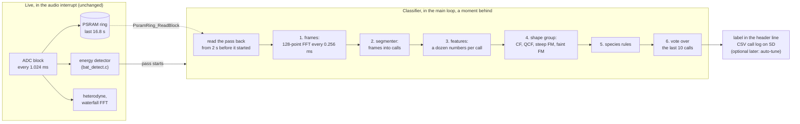
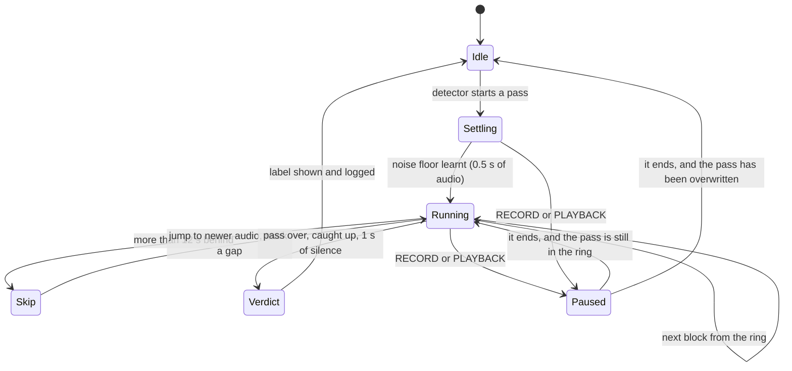
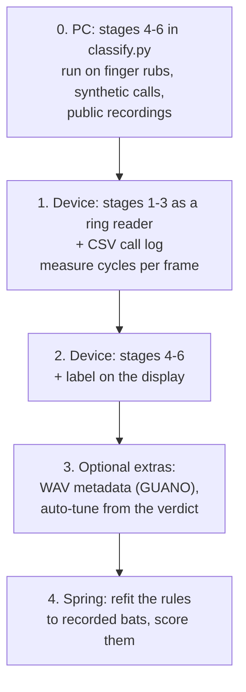

# Bat species classifier: the plan

How the species classifier in `Docs/Bat Species Classifier.md` (Oct 29) can be built on the V2 board as it stands on the `essential` branch: how it works, what it costs in RAM and CPU, what has to change from the original design, and the order to build and test it in.

Status: **plan agreed Nov 4. Step 0, the PC model of all six stages, is built and passes its bench tests (section 7).** Nothing on the board has changed yet. All CPU numbers are estimates scaled from measurements; step 1 of the build order measures them.

### Decisions (Nov 4)

1. **The label goes in the header line**, as a message for a few seconds after a pass. A status line of its own can come later if it needs one.
2. **It waits while a recording is open.** It picks up what's still in the ring once the recording closes.
3. **No auto-record.** Recording stays a button press.
4. **The species table is European**, not just the Pays de Gex. Island-only species are behind a region setting, off by default (section 3, "What it can name").

---

## 1. The short answer

**Yes, it can be built, and nothing in the audio pipeline needs to shrink for it.**

| | Needs | Available |
|---|---|---|
| RAM | about **4.5 KB** | 6.8 KB free (after removing USB and the debug code) |
| Flash | about 12–16 KB | 62 KB free |
| CPU | 25–44% of the CPU **while classifying** (13–22% with the cheaper frame setting) | It runs in the main loop's spare time, never in an interrupt |

The one big change from the original design: the classifier doesn't run live in an interrupt. It runs **a moment behind the live audio, reading each bat pass back from the PSRAM ring**, the same way the recorder does. The label appears a second or two after the calls. In exchange it can never disturb the audio, the ring or a recording, and it fits. It stands aside entirely while a recording or a playback is running.

The thing that limits it isn't the hardware, it's **data**. The species rules are literature values until they can be refitted to real bats recorded through this microphone and front end, and that means spring. Until then it can be built and tested on synthetic calls, public recordings and the odd mild-night pipistrelle, but its accuracy on real bats is unknown.

---

## 2. Would halving the pipeline help?

Two different things could be halved. Here's what each gives back:

| Change | RAM back | What it costs |
|---|---|---|
| **FFT 1024 → 512 points** (waterfall) | **3,072 B**: the working arrays 4 → 2 KB, the magnitudes 2 → 1 KB. Also ~5 KB of flash tables. | Bins go from 244 Hz to 488 Hz. The display's columns are 521 Hz each, so the waterfall's resolution barely changes, but a pure tone looks about 2 columns wide instead of 1. Frames are 2 ms instead of 4, which is better for short calls. One constant and a rerun of `gen_dsp_tables.py`. |
| **Blocks 256 → 128 samples** (the whole audio chain) | **about 1,600 B**: ADC, DAC and DSP output buffers, playback's slots; the ring's read queue has to double (+192 B) | Twice the interrupts. The recorder is built on "one block = one 512-byte sector" and would need reworking. The ring, recorder and playback are all verified on hardware and would need re-verifying. **Not worth it.** |

**Recommendation: halve neither, for now.** The classifier fits in the 6.8 KB that's free, with about 2.3 KB to spare. Keep the 512-point FFT as the reserve: if the classifier grows, it's a cheap 3 KB with almost no visible cost.

---

## 3. How it works

### The idea in one picture

The energy detector you already have stays as the **trigger**: it's cheap, it runs live, and it says when something is happening. The classifier then looks properly at what it was.

### Why not live, as the original design had it

The original design (written for 500 ksps, before the switch to 250 kHz) ran stages 1–3 in their own interrupt, all the time. At 250 kHz the same frames are a 128-point FFT every 64 samples: 3,906 frames a second. The design assumed CMSIS-DSP's FFT; this project uses its own (CMSIS-DSP didn't fit, diary 39).

Scaling the measured 1024-point FFT (216k cycles at `-O2`, interrupts included, diary 39) down by N log N gives **11–19k cycles per 128-point frame**, including the window, the noise floor and the peak pick. Here's how that sits against what's already running:

| | Not recording | Recording |
|---|---|---|
| Audio interrupt + PSRAM ring (measured) | 45% | ~63% |
| Classifier frames, live, every frame | +25–44% | +25–44% |
| **Total in interrupts** | **70–89%** | **88–107%** |
| Left for the main loop: display, SD writes | 11–30% | **none** |

Live, it doesn't fit while recording. The recorder's polled SD writes need the main loop, and an overloaded audio interrupt would be audible.

Reading the pass back from the ring removes the deadline:

- The classifier uses whatever main-loop time is spare.
- If it's short of time it falls behind, and catches up when the pass ends.
- It can never make the audio stutter or the ring miss a burst. It's just another reader of the ring, like the recorder and playback.

### The classifier as a reader of the ring

- **Where it starts.** 2 s before the detector's pass began. The detector fires on the third pulse, up to ~1.2 s after the first, so this catches the first calls and leaves 0.5 s before them for the noise floor to settle. It never reads from before the ring last resumed: playback pauses the ring (`PsramRing_GetResumeBlock`).
- **How it reads.** One block at a time, into two 512-byte slots: one being processed while the next loads. This is what playback already does.
- **How far behind it can be.** The ring holds 16.8 s. Past 12 s behind, it jumps forward and marks the gap rather than reading audio that's about to be overwritten. That's the project's "drop rather than corrupt" rule. A verdict needs only 5–10 calls, which is about a second of a pass.
- **Recordings and playback come first.** The classifier doesn't run while a recording is open or saving, or during playback, when the ring is paused and has no new audio.
  - When a recording ends, it picks up whatever pass audio is still in the ring, up to 12 s back.
  - So the recorder and the classifier never compete for the ring or the CPU.
  - Otherwise it runs after `Recorder_Poll` in the main loop, with a time slice (say 10 ms a turn), so the display and FFT keep going.
- **How late the label is.** About 1–3 s after the calls. After a recording, it comes once the recording closes, if the pass is still in the ring.

### The six stages (what each does)

The detail is in `Docs/Bat Species Classifier.md`; this is what each stage is for, at the 250 kHz parameters, with the corrections the PC model found (diary 43).

**1. Frames.** Every 64 samples (0.256 ms), take the last 128 samples, apply a Hann window, FFT. That gives 65 bins of 1.95 kHz, of which 57 are used (9.8–119 kHz). For each frame, find the bin furthest above its own **noise floor**, then interpolate between bins to get the frequency to a fraction of a bin.
- Comparing each bin to its own noise floor ("whitening") is what makes a steady insect tone or the 24.9 kHz line invisible: they sit in their own floor. A pulsed insect isn't invisible: each pulse is a call, frame by frame (diary 50).
- The floor is learnt only between calls.
- From the PC model: SNR is measured against the mean noise rather than the floor as tracked (+6 dB). The doc's values gave 29,000 false calls a minute on the board's own noise.

**2. Segmenter.** Turns frames into calls. A call starts after 2 frames more than 12 dB above the noise. It ends after 3 weak frames: below 9 dB, or more than 24 dB below the call's own peak, so echoes don't stretch it. A jump **up** in frequency of more than 8 kHz starts a new call, because calls sweep down or hold. Fewer than 3 strong frames is a click, not a call.
- From the real recordings (diary 50): in a call, the peak is searched for only down to 16 kHz below the last point, the steepest sweep per frame. Otherwise a call jumps to whatever else is loudest: a horseshoe's 108 kHz call to its 54 kHz fundamental, a pipistrelle to an insect at 11 kHz. The 8 kHz rise rule also applies while a call is starting.

**3. Features.** For each call:
- duration;
- start, end and peak frequency;
- the characteristic frequency (the end of the flattest part);
- bandwidth;
- the slope at the start, middle and end;
- how much of the call is flat;
- SNR;
- whether there's a second harmonic;
- the interval since the last call.

These are a dozen numbers from a track of up to 320 frames (82 ms, longer than any horseshoe call).

**4. Shape group.** Four tests, most specific first:
- **CF:** a long constant tone above 70 kHz (horseshoes);
- **QCF:** an FM sweep into a flat tail (pipistrelles, noctule, serotine, Leisler's...);
- **steep FM:** a broad, fast sweep (*Myotis*);
- **faint FM:** short, low-starting sweeps (long-eareds, barbastelle).

Anything else votes "Bat sp.".

**5. Species rules.** Inside a group, compare the features to a table of ranges per species. For example, characteristic frequency 42–49 kHz is common pipistrelle and 53–58 kHz is soprano.
- Scores fall off gently outside a range instead of cutting hard.
- If the runner-up scores close to the winner, the call votes for their common group instead of guessing.
- The table is in flash, and it's the part that gets refitted in spring.

**6. Vote.** Over the last 10 calls, weighted by their quality. A species needs 60% of the vote and 5 calls. Otherwise it rolls up to the group ("Pipistrelle sp.", "*Myotis* sp.", "Nyctaloid"), and if that's still unclear, to "Bat sp.". Some cues only exist across calls, and they're applied here too:
- a noctule alternates between two notes;
- a barbastelle alternates two call types.

**Honest labels.** Some species can't be separated by their calls at all: whiskered/Brandt's, the Natterer's complex, the two mouse-eared bats. They exist only as group labels, so the classifier can never claim them. The microphone is rated to about 80 kHz, so the lesser horseshoe (105–112 kHz) may never be heard.

### Rubs: what the PC model found

The energy detector can't tell a finger rub from a bat (diary 44): both are loud ultrasound. In the PC model the six stages alone couldn't either. Two synthetic rubs (5–60 ms bursts of broadband noise at irregular intervals, one flat and one falling 6 dB per octave) gave about 8,000 false calls a minute, labelled "Myotis sp." and "long-eared".

What separates them is how much of the spectrum a frame lifts:
- A call is a tone or a sweep. It lifts a few bins and leaves the rest at the noise floor. In every frame of every bench call, the **median** bin (after whitening) is within **2.1 dB** of the mean noise. That includes a Natterer's sweep covering 30 kHz per frame.
- A rub lifts the whole band. In the synthetic rubs, the median bin is **14.6 dB** or more above it.

So stages 1–2 gained four rules (new, not in the original design):

| Rule | Catches |
|---|---|
| A frame is broadband if more than half its bins are more than 6 dB up (the median is up) | the body of a rub |
| ... or if more than half its bins are within 10 dB of the loudest | a rub's rising and falling edges, where the median is still low but the spectrum is flat |
| A call is dropped if most of its frames have a median more than 3 dB up | rub fragments that slipped through |
| A call that rises more than 5 kHz doesn't vote | echolocation calls fall or hold; rub fragments jump about |

A broadband frame can't start or continue a call. In C, each rule is a count over the 57 bins, about 300 cycles a frame together.

Result: both synthetic rubs now report nothing. The bat signals are unaffected, and the quietest pipistrelle found is unchanged (20/20 at −5 dB). **The real test is your finger-rub, typing and trouser WAVs from the old SD card.** A real rub may have a different spectrum, for example energy only below 40 kHz, which would leave the median at the noise. Those WAVs are the next thing to run.

### What it can name (European table)

From `Docs/European Bat Calls — Species, Frequencies & Acoustic ID.md`. Where species can't be told apart by their calls, or only by where they live, they exist only as a group, so the classifier can never claim one of them.

| Can be named as a species | Only ever a group |
|---|---|
| Greater horseshoe, Blasius's horseshoe | Lesser / Mediterranean / Mehely's horseshoe (range only; also above the microphone's 80 kHz rating) |
| Common pipistrelle, soprano pipistrelle, Schreiber's bat | Kuhl's / Nathusius' pipistrelle (social calls only) |
| Savi's pipistrelle | Serotine / isabelline serotine (range only) |
| Noctule, greater noctule, Leisler's bat (by alternation), northern bat, parti-coloured bat | Nyctaloid group (when the rhythm doesn't decide) |
| European free-tailed bat | Natterer's / Escalera's / cryptic myotis; Geoffroy's / Alcathoe; mouse-eared bats |
| Long-fingered bat | *Myotis* sp. (Daubenton's, whiskered/Brandt's, Bechstein's, pond bat) |
| Barbastelle (by its alternating calls) | *Plecotus* sp. (long-eared bats) |

- **The region setting:** the Crete and Madeira pipistrelles are off by default. Their bands overlap the common pipistrelle's, so leaving them on would turn every common pipistrelle into "Pipistrelle group".
- **Why the 6-letter codes:** they're the ones bat software uses, and they fit the header line: "PIPPIP 87%  9" is the code, the confidence and the number of calls.

---

## 4. RAM

At 250 kHz: 128-point frames, 64-sample hop.

| What | Bytes | Notes |
|---|---|---|
| Ring read slots | 1,024 | 2 × 512 B: one processed while the next loads |
| Frame overlap | 128 | The previous 64 samples, so frames can straddle blocks |
| FFT working arrays | 512 | 64 + 64 floats: the same packed real-FFT trick as `fft.c` |
| Power spectrum | 260 | 65 floats |
| Noise floor | 228 | 57 floats, one per analysed bin |
| Call track | 1,280 | 320 frames × 4 B (frequency, SNR, flags): 82 ms |
| Current call's features | 64 | |
| Sequence ring | 384 | The last 16 calls' labels, weights and the features voting needs |
| State and result | ~200 | Segmenter, sequence, the published verdict |
| Call log buffer | 512 | One sector of CSV lines, so the log is written a whole sector at a time |
| **Total** | **~4.5 KB** | Against 6.8 KB free: **~2.3 KB to spare** |

Compared with the original design's 5.4 KB:
- Frames at 128 points need half the FFT buffers of 256.
- There's no interrupt-to-main-loop call queue (512 B), because everything runs in one place.
- The ring read slots (+1 KB) are new.

All of it is fixed static arrays: no `malloc`.

If it ever needs more:
1. **The 512-point waterfall FFT:** +3 KB (section 2).
2. **The recorder's 8 KB buffer**, borrowed while not recording, if classification during a recording can be given up.

**Flash.** About 12–16 KB of the 62 KB free:
- the FFT-128 tables (window, twiddles, unpack: ~1.3 KB, generated by `gen_dsp_tables.py` like the others);
- the taxon and rule tables (~2 KB);
- the code.

---

## 5. CPU

| | Estimate | How it's measured (step 1) |
|---|---|---|
| One 128-point frame, all of stage 1 | 11–19k cycles | DWT cycle counter around the frame function, read in CubeIDE's Live Expressions |
| Classifying in real time, every frame | 25–44% of the CPU | 3,906 frames/s × the above |
| The same with a 128-sample hop (no overlap) | 13–22% | Half the frames; 0.512 ms time steps |
| Reading the pass from the ring | ~7% | The ring's burst interrupt for one extra real-time read stream (measured: 45% → 66% for about three) |
| Stages 4–6 | under 1% | Once per call, ≤ 40 calls/s |

It never runs during a recording, so the main loop's share is the not-recording one: about 55% of the CPU. Classifying at full speed plus its ring reads takes 32–51% of the CPU, so it about keeps up with real time at the 64-sample hop. At the 128-sample hop it keeps up comfortably. While it's classifying, the waterfall gets fewer FFT frames: still peak-held, just less complete.

The hop is a constant: start at 64, measure, and drop to 128 if it can't keep up. The original design notes 128 is fine for pipistrelles, noctules and horseshoes, and marginal for the shortest (1–2 ms) *Myotis* calls.

---

## 6. Data: the real limit

- **No real bats yet.** The detector's own recordings are finger rubs. Most bats are hibernating until spring; pipistrelles do fly on mild winter nights, so the odd pass is possible.
- **Until spring:**
  - the synthetic calls (`Archive/Tools/bat_signals.py`), made in the board's measured noise;
  - public full-spectrum bat call libraries (for example ChiroVox), resampled to 250 kHz. These are good for checking the shape groups and the rough ranges, but they're recorded through other microphones, so they're not for fitting the final thresholds;
  - your finger-rub, typing and sensor WAVs, for the "no bat" side.
- **In spring:**
  - Record passes, label them (by ear and spectrogram, or with desktop software), and refit the rule ranges to what this microphone and front end actually deliver.
  - Score two numbers per group:
    - **wrong-species rate**: it named a species and was wrong. This is the one to drive down;
    - **fallback rate**: it said "group" where a species was possible. This is the price of honesty.
- **The call log is the training set.** One CSV row per call (block number, every feature, group, label, score) means every pass the device hears in spring is data, even before the rules are right.

---

## 7. Build order

Each step is useful on its own, and each can be checked without USB.

**0. On the PC first. Built Nov 4.**
- `Tools/classify.py` does stages 1–3 (back from the archive) and `Tools/species.py` does stages 4–6 with the European table. `python -I Tools/classify.py --selftest` must pass after any change.
- Bench results, synthetic calls at +20 dB re the board's noise:

| Bench signal | Verdict |
|---|---|
| 82 kHz CF, 50 ms | Greater horseshoe, 100% |
| Sweep 100 → 30 kHz in 3 ms | *Myotis* sp.: no European rule ends at 30 kHz, which is right |
| Sweep 110 → 15 kHz in 1.5 ms | Natterer's complex, 43% |
| Pipistrelle, tail 45 kHz | Common pipistrelle, 100% |
| Pipistrelle, tail 55 kHz | Soprano pipistrelle, 100% |
| 15 ms calls alternating 20 / 24 kHz | Noctule (by alternation) |
| 9 ms calls alternating 24.5 / 27.5 kHz | Leisler's bat (by alternation) |
| 11 ms calls ending at 25 kHz, no alternation | Nyctaloid group, as the reference doc expects |
| Pipistrelle under a 40 kHz tone 10 dB louder | Common pipistrelle |
| Pipistrelle with an echo 8 ms later | Common pipistrelle; 25/25 echoes rejected |
| 60 s of noise | Nothing |
| Two synthetic rubs | Nothing (was ~8,000 false calls/min before the rub rules) |

- **Real recordings (Nov 4, diary 49):** the Zenodo "Bat recordings split data set" (record 3247097), common and soprano pipistrelles at 256 kHz, rebuilt into 444 continuous recordings, 1,002 s in all (`Tools/real_calls.py`).
  - Five rule changes came out of it (diary 49): narrow calls are QCF, sane sweep ends, no frequency rule for Schreiber's bat, below-band energy doesn't vote, and band-group fallbacks.

  | Real recordings | Named right | Wrong species | Group | Bat sp. |
  |---|---|---|---|---|
  | Common pipistrelle (246) | 41% | 1% | 18% | 40% |
  | Soprano pipistrelle (198) | 10% | 15% | 30% | 45% |

  - 96% of the dataset's calls are found. Its "silent" stretches give ~820 detections a minute, mostly 10–20 kHz sounds (diary 50).
  - **Common vs soprano doesn't separate on this data.** Its sopranos sit mostly at 50–52 kHz, not the textbook 53–58, just above its commons at 48–50. So the labels are in doubt.
  - A boundary fitted on half the nights (50.2–50.6 kHz) didn't improve the other half.
  - The table is after the tracking change of diary 50. Before it: common 37% right, soprano 12% wrong.
- **Labelled recordings (Nov 4, diary 50):** 31 xeno-canto and 9 Biodiversity Ireland files, 11 species (`Tools/labelled_calls.py`).
  - **Common and soprano separate cleanly.** Per file, the median f_char of the pipistrelle-band calls is 42.9–48.3 kHz for common and 54.4–58.5 kHz for soprano. Nathusius' is at 39–41 kHz.
  - **Verdicts:** 12 right, 9 group (5 of them serotines as Nyctaloid group, as intended), 10 "Bat sp.", 9 wrong.
  - **What's wrong:** sound at 10–35 kHz that isn't echolocation (pipistrelle social calls, insects) wins the vote, which is over the last 10 calls. A second bat at the end of a pass does too. The Myotis recordings (one per species) aren't reliable yet.
- **Still to do on the PC:**
  - keep social calls out of the vote: a burst of pieces in 15–30 kHz within ~60 ms is one social call;
  - a pass verdict that can name two bats;
  - your finger-rub, typing and trouser WAVs.

**1. Stages 1–3 on the device, with the call log. Built Nov 4 with step 2 (diary 51); not yet run on the board.** `Core/DSP/classifier.c` reads the ring; `classifier_calls.c` has stages 1–3 with its own small 64-point FFT (fft.c is untouched) and a second set of generated tables. `Tools/check_classifier_c.py` builds the C on the PC with gcc and checks it against the model: all 17,519 calls of the 40 labelled recordings match within a frame, and all 59 sequence verdicts.
- **The check:** make a short recording (under 12 s) of the 40 kHz sensor or a pass. When it closes, the classifier works through the same audio from the ring and logs its calls. Run `classify.py` on the WAV and compare: both see the same samples, so their call lists should match within a bin in frequency and a frame in time. They're lined up by block number.
- Measure cycles per frame in Live Expressions, to settle the hop.

**2. Stages 4–6 and the label. Built Nov 4 (`classifier_species.c`).** Rules and taxa as tables in flash. The verdict shows in the header line for a few seconds after a pass, for example "PIPPIP 87% 9" (13 characters), and goes in the log.

**3. Optional extras.** No auto-record (decided Nov 4).
- **GUANO metadata:** when a recording's audio is classified after it closes, the verdict can go into the WAV header's 460-byte pad by rewriting sector 0 once. The field for an automatic ID is `Species Auto ID`.
- **Auto-tune** could take the classifier's frequency. Today's auto-tune keeps working as it is.

**4. Spring.** Refit, score, and only then trust the species names.

---

## 8. Risks and open questions

**Risks**
- **CPU** is estimated, not measured. Step 1 measures it, and the 128-sample hop is the fallback.
- **Real rubs** may not look like the synthetic ones (section 3). Your WAVs decide it.
- **Accuracy** is unknown until spring, especially for the nyctaloids, which overlap in frequency, and for *Myotis*.
- **The microphone** above 80 kHz: unmeasured.

**Still open**
- The per-call CSV log is text (about 100 bytes a call), not audio. It's the validation record for step 1 and the training set for spring. On by default (decided Nov 4).
