# How the bat detector works

This explains the firmware on the `essential` branch: what each part does, how they fit together, and why the numbers are what they are. The diagrams are Mermaid, so they render on GitHub and in VS Code's Markdown preview.

The `v2` branch is the same product with the bring-up instrumentation still in: the USB debug link, the stats table, the `Core/Diag` library and the PC capture tools. Everything here behaves the same on both.

---

## 1. What the box does

A MEMS microphone hears ultrasound from 20 to 120 kHz. The firmware does five jobs with it, all at once:

| Job | What you get | Where |
|---|---|---|
| **Heterodyne** | Bat calls shifted down into the audible range, live on the speaker | `dsp.c` |
| **Waterfall** | A scrolling spectrogram of 0–125 kHz on the display | `fft.c`, `waterfall.c` |
| **Detector** | LED0 lights during a bat pass, LED1 flashes on each call | `bat_detect.c` |
| **Auto-tune** | In auto mode, the heterodyne follows the bats' frequency | `autotune.c` |
| **Memory** | The last 16.8 s of raw audio always kept in PSRAM, for **playback** 10× slower (time expansion) and **recording** to SD as WAV, starting 5 s before the press | `psram_ring.c`, `playback.c`, `recorder.c` |
| **Species** | After a pass, the bat's species or group in the header line ("PIPPIP 87%  9"), and the verdict logged to `CALLS.CSV` | `classifier.c`, `call_log.c` |

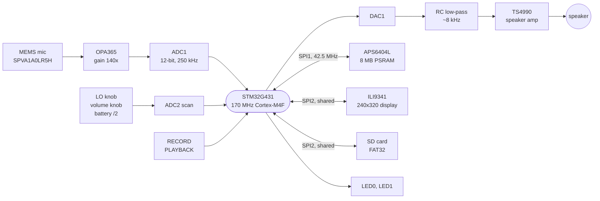

---

## 2. The big picture: three things running at once

The code runs in three places. Most of understanding the firmware is knowing which code runs where.

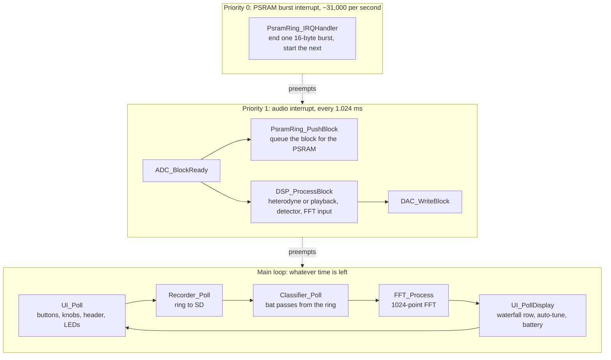

**The audio interrupt** is the heart of it. TIM2 triggers the ADC and the DAC 250,000 times a second. DMA moves samples between them and memory, and every 256 samples (1.024 ms) the ADC's DMA interrupt hands a block to the DSP. Everything in it has a hard deadline: the next block arrives in 1.024 ms whatever happens. One block is 174,080 CPU cycles. The DSP uses about 37% of that, or about 45% with the PSRAM writes running.

**The PSRAM burst interrupt** is the most urgent thing on the chip. The PSRAM must not have its chip-select (CE#) held low for more than 8 µs, or it misses its refresh and loses data. So every burst's end is handled at priority 0, ahead of everything else. That includes the audio.

**The main loop** does everything slow or blocking: SD writes (up to 20 ms each), the FFT (about 1.3 ms), the species classifier, and display drawing over SPI. These can't go in an interrupt because they'd hold up the audio.

The two halves talk through small shared variables. The interrupt sets them and the main loop reads them, or the other way round: `fftMagnitudeReady`, the PSRAM ring's block counters, `BatDetect_IsBatPresent()`, and the volume and LO settings.

---

## 3. Sample rate, blocks and timing

Everything is derived from `Core/Inc/pipeline_config.h`. Nothing else hard-codes these numbers.

| Constant | Value | Why |
|---|---|---|
| `AUDIO_SAMPLE_RATE_HZ` | 250,000 | 170 MHz / 680 (TIM2). Nyquist is 125 kHz, above the 100 kHz the detector must hear. |
| `AUDIO_BLOCK_SIZE` | 256 samples = 1.024 ms | Big enough that the per-block overhead is small, small enough that the audio delay isn't noticeable. |
| `AUDIO_BUFFER_SIZE` | 512 | Two blocks: the DMA fills one half while the CPU works on the other. |
| `AUDIO_FFT_LENGTH` | 1024 | 244 Hz bins; 4.1 ms of audio per frame. |
| `AUDIO_LO_MAX_HZ` | 120,000 | The top of the LO knob. |
| `PLAYBACK_EXPANSION` | 10 | Time expansion factor. |

### Ping-pong buffers

Both the ADC and DAC buffers are circular DMA buffers of two blocks. The DMA never stops. The CPU always works on the half the DMA isn't touching.

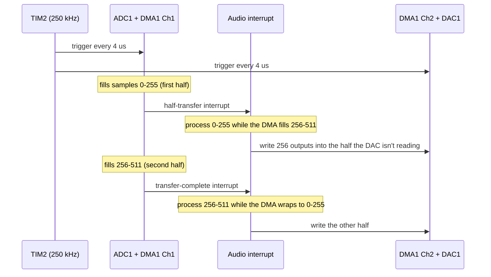

`dac.c` chooses which DAC half to write by reading the DMA's remaining count (`CNDTR`): if the DMA is in the second half, write the first. That way the output always lands where the DAC will read it next, whatever the start-up offset between the ADC and DAC was.

The start order in `main.c` matters: DAC armed, then ADC armed, then TIM2 started. Both peripherals are waiting before the first trigger arrives.

---

## 4. The audio chain (`dsp.c`)

`DSP_ProcessBlock` runs once per block, in the audio interrupt. Per sample:

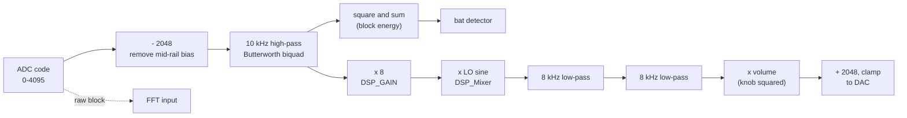

During playback, the mixer and low-passes are skipped, and `Playback_Render` fills the output instead. The high-pass, detector and FFT keep running, so the LEDs and waterfall stay live.

### Why heterodyne works

Multiplying two sine waves gives their sum and difference frequencies:

  cos(a) · cos(b) = ½ cos(a − b) + ½ cos(a + b)

A pipistrelle calling at 45 kHz, mixed with a 43.5 kHz LO, gives 1.5 kHz (audible) and 88.5 kHz. The two 8 kHz low-pass filters remove the 88.5 kHz, and everything else more than 8 kHz from the LO. What's left is the ultrasound near the LO, moved down to 0–8 kHz. Turn the LO knob and a different slice of the ultrasound becomes audible. That's why a heterodyne detector has to be tuned, and why auto-tune is useful.

The ½ is why playback uses `DSP_GAIN / 2`: it has no mixer, so it would otherwise be twice as loud.

### The oscillator (NCO)

The LO is a 32-bit phase accumulator. Each sample adds a fixed step:

  step = f_LO × 2³² / 250,000

so for 45 kHz the step is 773,094,113, and the phase wraps round 45,000 times a second. The top 9 bits of the phase (`phase >> 23`) index a 512-entry sine table in flash (`Core/DSP/Tables/`, generated by `Tools/gen_dsp_tables.py`). It's a table lookup and a multiply per sample: no `sinf()`.

### The filters (`dsp_filters.c`)

Each filter is a biquad, a second-order IIR filter with five coefficients:

  y[n] = b0·x[n] + b1·x[n−1] + b2·x[n−2] − a1·y[n−1] − a2·y[n−2]

The coefficients come from the bilinear transform of a Butterworth prototype, calculated once at start-up from the cut-off frequency and the sample rate. Two 8 kHz low-passes in a row make a 4th-order filter: −24 dB/octave, so 88 kHz (the sum frequency) is down by more than 80 dB.

---

## 5. The PSRAM ring (`psram_ring.c`)

The PSRAM is 8 MB: 16,384 blocks of 512 bytes (256 samples × 2 bytes). At one block per 1.024 ms that's 16.8 s. Every audio block is written into the next slot, wrapping round, so the PSRAM always holds the last 16.8 s.

Block numbers count up forever (block *n* lives at address (*n* mod 16384) × 512). So "block 52,000" means the same audio whether you're writing or reading it, and anything older than 16,384 blocks behind the writer has been overwritten.

### Bursts

The APS6404L can't hold CE# low for more than 8 µs (t_CEM). At 42.5 MHz one byte takes 0.19 µs, so a burst can carry only about 32 bytes. With the command and address it's less. The ring uses 16 data bytes per burst:

| Burst | Bytes on the wire | Time |
|---|---|---|
| Write | 0x02 + 3 address + 16 data = 20 | 3.8 µs |
| Read | 0x0B + 3 address + 1 wait + 16 data = 21 | 4.0 µs |

32-byte bursts were tried. Reads reached 8.1 µs, which is over the limit (diary 36).

One block is 32 bursts. They are chained by interrupts, with no CPU involvement during a burst:

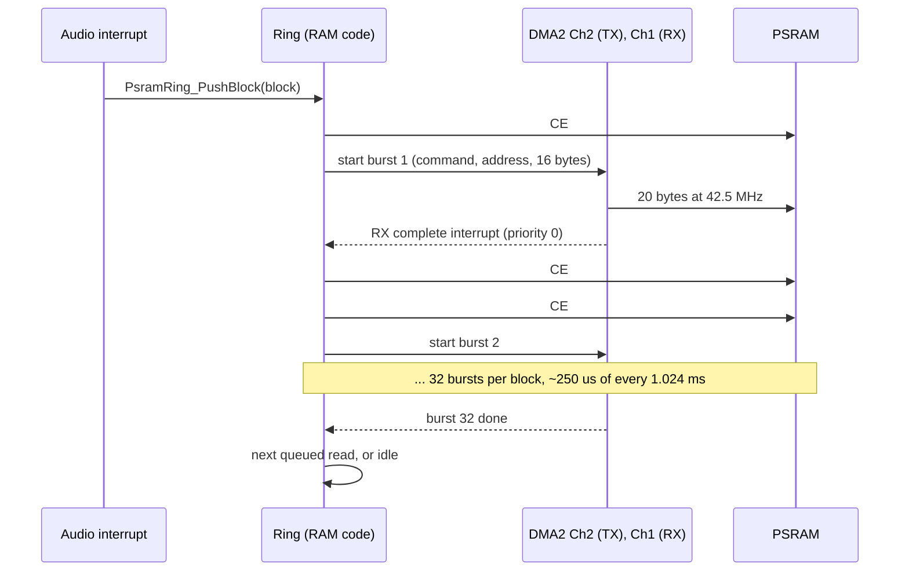

Why the RX channel, not TX? TX finishes when the last byte has gone into the SPI's FIFO, before it's on the wire. RX finishes when the last byte has come back, which is exactly when the bus is idle and CE# can rise.

Why so careful? The burst interrupt runs about 31,000 times a second. From flash at `-Og` it took 4 µs a burst and starved the audio. So:

- it runs from RAM (`__RAM_FUNC`);
- the file is built at `-O2`;
- its helpers are forced inline;
- the handler returns before the HAL's generic DMA handler.

It now takes about 2.3 µs.

### Reads

Playback and the recorder ask for blocks with `PsramRing_ReadBlock(block, dest, &done)`. That queues a read (up to 16 in the queue) and returns at once. The ring does it after the current write, and sets `done` to `PSRAM_RING_DONE` (or `FAILED`) when the data is in `dest`. Writes always go first: losing live audio is worse than a late read.

A read is refused (`READ_INVALID`) if the block is older than 16,384 − 64 blocks. The 64 are a guard band, so the writer can't overwrite a block while it's being read.

### Pausing

Playback pauses the ring (`PsramRing_SetPaused`), so the 2 s being played isn't overwritten while it plays. Block numbers carry on across a pause. `PsramRing_GetResumeBlock()` returns the first block after it, so a recording's pre-trigger never joins audio from both sides of a playback.

### Start-up checks

`PsramRing_Start()` refuses to run if something CubeMX could have changed would break the timing:

- SPI1 not 8-bit, or not at /4;
- NSS pulse mode on (it adds 2 idle clocks per byte, and pushed bursts over 8 µs once);
- PB3–5 not High speed;
- DMA2 Ch1 not alone at priority 0.

The boot screen then says "Ring: SPI1 config" or "Ring: NVIC prio".

---

## 6. Recording to SD (`recorder.c`, `sd_spi.c`)

RECORD starts a WAV file that begins 5 s **before** the press, taken from the ring. Recording carries on with live audio until RECORD is pressed again (or 10 minutes).

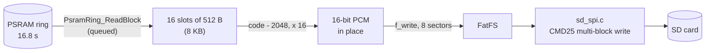

The SD card is the slow, unpredictable part. Writes usually take 5–15 ms but can stall for over 100 ms while the card erases. The ring is what makes this work: the audio is already safe in PSRAM. The recorder just has to copy it out faster than 500 kB/s on average, and it has 16.8 s of slack.

Measured: 8-sector writes run at 1.38× real time while catching up and 1.93× once caught up. Single-sector writes manage only 0.88×, which is why the recorder writes 8 at a time (diary 38–40).

### How `Recorder_Poll` works

Each call works for up to 20 ms, then returns so the display and FFT get a turn.

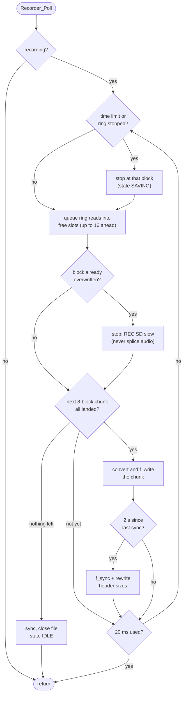

### The recorder's states

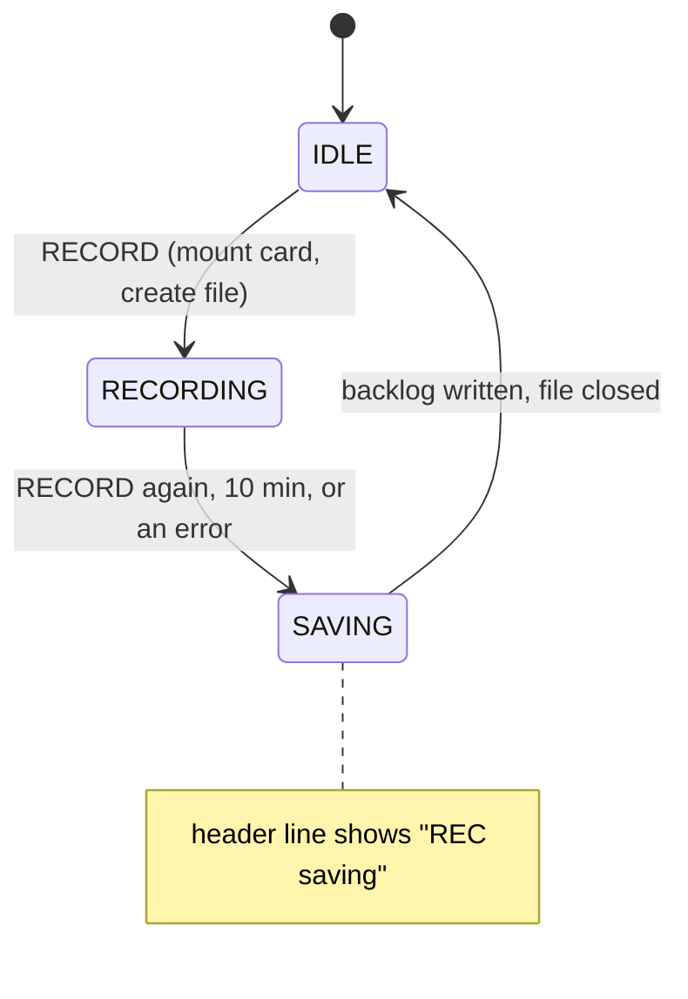

### The file

```
sector 0     WAV header, 512 bytes: RIFF, fmt (PCM, mono, 16-bit, 250 kHz),
             a 460-byte JUNK pad, then the data chunk header
sector 1..   audio: one 512-byte ring block (256 samples) per sector
```

Most WAV files have a 44-byte header. This one fills a whole sector so the audio stays sector-aligned. Every `f_write` is then whole sectors, which FatFS hands straight to the card without its read-modify-write. The first chunk is 7 blocks, so later chunks of 8 land on 8-sector boundaries and never cross a 32 KB cluster.

Every 2 s the recorder calls `f_sync` (FatFS writes the file size and FAT) and then rewrites the header's sizes directly into sector 0. A power cut loses at most the last 2 s.

### The SD driver

The G431 has no SD host controller, so the card runs in SPI mode on SPI2, shared with the display. It's polled and blocking. Every exchange is a command frame (6 bytes), then a 1-byte reply (R1), then data blocks with start tokens. Every wait has a timeout.

Start-up (`SD_Init`) runs at 332 kHz, because cards must start at 400 kHz or less:

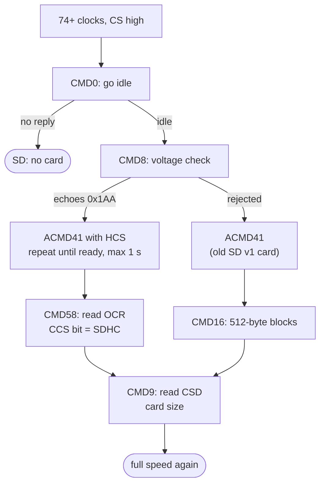

If a read or write fails, the driver runs `SD_Init` again and retries once. CMD0 resets the card's state machine, whatever it thought was happening. That turned occasional glitches into non-events during the SD bring-up (diary 40).

---

## 7. Time-expansion playback (`playback.c`)

A short press on PLAYBACK replays the last 2 s from the ring, 10× slower: 20 s of audio at a tenth of the pitch. A 45 kHz call plays at 4.5 kHz, with its shape intact. That's something a heterodyne can't give you.

- The DAC keeps running at 250 kHz. Each output sample steps a tenth of a sample through the recording, interpolating linearly between neighbours. A 32-bit fixed-point position does this, with the step 2³²/10.
- The input goes through the same 10 kHz high-pass first, to drop the bias and room noise.
- Two 512-byte slots: one block plays (10 ms at 10×) while the next loads from the ring (about 0.25 ms).
- The ring is paused for the whole playback and resumes after it.

Playback and recording exclude each other: playback pauses the ring the recorder reads from. "PLAY: busy" and "REC: playing" say so.

---

## 8. The bat detector (`bat_detect.c`)

Once per block, the detector gets the block's energy above 10 kHz: the sum of the squared high-pass outputs. It looks for the rhythm of echolocation: short pulses, repeating.

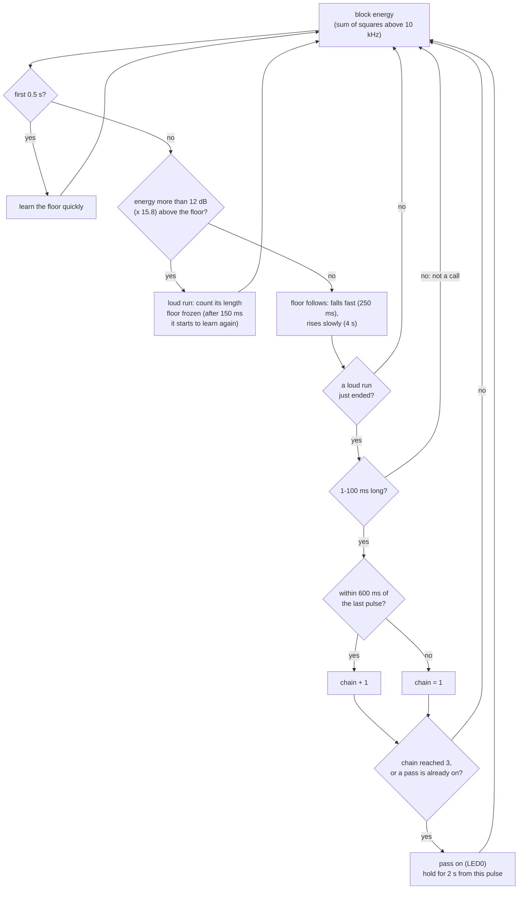

- **Energy, not samples.** One number per block (1.024 ms) is enough to see a call (1–30 ms) and cheap enough to run in the interrupt. The comparison is done on linear energy, so there's no `log10f` per block: 12 dB is a factor of 15.8.
- **Floor tracker.** It follows the background level, falling fast and rising slowly, so a bat pass can't raise the floor and hide itself. During a loud run the floor is frozen. But a run that lasts over 150 ms is a steady noise rather than a call, so the floor starts learning it again, or the detector would be stuck "loud" for ever. For the first 0.5 s it learns quickly.
- **Pulse length.** A run of 1–100 ms is a pulse. Anything longer is wind, rustling or a tone.
- **Chain.** One pulse could be anything. Three in a row, each within 600 ms of the last, is a bat. The slowest European caller, the noctule, calls every ~0.45 s. Once a pass is on, every pulse restarts its 2 s hold.

LED1 flashes for 50 ms on each pulse, but only during a pass, so stray clicks stay dark.

Known limit: rubbing fingers or cloth makes real broadband ultrasound, 40 dB above the floor, and the detector can't tell it from a call by energy alone. It would need a tonality test (a call is a tone or a sweep; a rub is broadband). That's on the list (diary 44).

---

## 9. The waterfall (`fft.c`, `waterfall.c`)

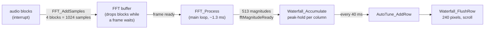

**The FFT.** 1024 real samples are packed into a 512-point complex FFT: even samples as the real parts, odd as the imaginary. It's a radix-2 FFT with a Hann window. The two halves are then separated with the real-FFT identity, giving 513 bins of 244 Hz each, from 0 to 125 kHz. That's about half the work of a 1024-point complex FFT. The window, twiddle factors and unpack rotation are tables in flash. The bit reversal uses the M4's `RBIT` instruction. It takes about 1.3 ms per frame (216k cycles at `-O2`, audio interrupts included). The library version (CMSIS-DSP) needed a 4 KB buffer that doesn't fit.

The interrupt only copies samples in. The FFT itself runs in the main loop. If the main loop is busy (an SD write, say), frames are skipped, never half-overwritten.

**Columns.** Bins 0–1 (DC) are dropped. The other 511 are shared over 240 columns, about 2.1 bins (0.52 kHz) per column. Each column keeps the **peak** of every frame since the last row, so a 2 ms call that falls in one frame still shows.

**Scrolling.** The ILI9341 has hardware vertical scrolling. The firmware draws each new row (240 pixels, one SPI write) one line above the last, and moves the display's scroll start to it. Nothing else is redrawn. The header (34 px) and the axis strip (14 px) are fixed areas that don't scroll.

**Colour.** The column's dB value maps onto black → blue → cyan → green → red between −10 and +20 dB (`Waterfall_SetRange` in `main.c`).

---

## 10. Auto-tune (`autotune.c`)

Auto-tune uses the waterfall's rows, not the raw FFT: they're already peak-held and 40 ms apart, which suits call rates of 5–20 a second.

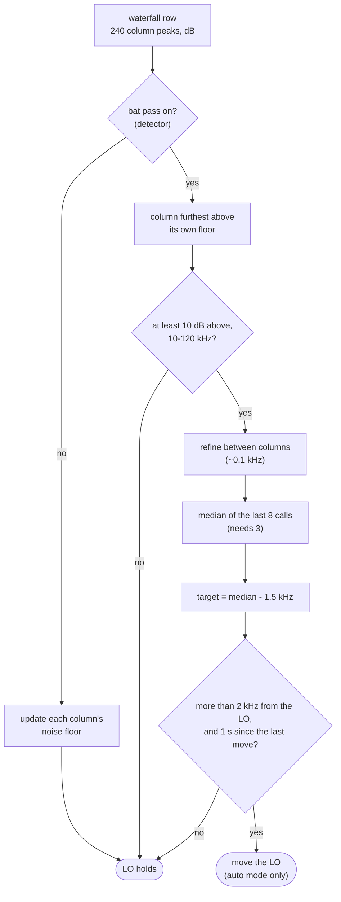

- **Per-column floors.** A steady tone (there's one at 24.95 kHz on the bench) sits in its own column's floor and never wins. A bat call stands out against the floor of the column it's in.
- **The median of 8.** One mis-measured call can't move the LO.
- **1.5 kHz below.** A call's steady tail then beats at 1.5 kHz, an audible tone, rather than near 0 Hz, which is silent.
- **The 2 kHz step and 1 s hold.** These stop the LO wandering, which sounds terrible.

It learns in both modes. In manual mode its answer is ignored, so switching to auto takes effect at once.

---

## 11. The species classifier (`classifier.c`)

After a bat pass it names the bat: "PIPPIP 87%  9" in the header line for 5 s, in yellow. That's the species or group code, the confidence and the number of calls. How it decides, and how well it does on real recordings, is in `Docs/CLASSIFIER_FINDINGS.md`; the design and its costs are in `Docs/CLASSIFIER_PLAN.md`.

It doesn't listen live. It reads each pass back from the PSRAM ring in the main loop, a second or two behind, the way playback reads it:

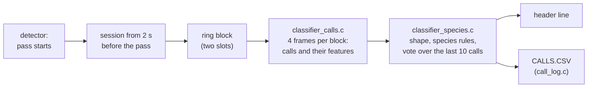

- **A session** runs from 2 s before the detector's pass began until the pass is over (2 s after its last pulse) and the classifier has caught up with the ring. The first 0.52 s of it only learn the noise floor.
- **It stands aside** while a recording is open or saving, and during playback. A pass that starts meanwhile is picked up afterwards, if it's still in the ring.
- **It never reads audio about to be overwritten.** More than 12 s behind, or across a playback pause, it ends the session and starts again on newer audio. `classifierSkips` counts these.
- **Each sequence** (calls less than 1 s apart, 3 or more of them) gets a verdict, shown in the header and written as one line to `CALLS.CSV` on the card: its ring position (in 64-sample hops), the number of calls, the code and the confidence. Detections it doesn't report aren't written.
- **Faint-sweep verdicts** ("FAINT", "PLESP", "BARBAR": long-eared bats and barbastelle) are neither shown nor logged, because indoor noise and taps were named that way too easily. `CLASSIFIER_REPORT_FAINT` in `classifier.h` turns them back on. With `CALL_LOG_CALLS` set in `call_log.h`, every call is a line too, with its measurements, shape group and label (columns in `classifier_species.h`); that's for checking the board against the PC model, and it's off because it grows fast.
- **The log** collects lines in a 512-byte buffer. When the buffer fills, and at the end of each pass, it mounts the card, appends to the file and closes it again, so nothing is left open when the recorder takes the card.

`classifier_calls.c` and `classifier_species.c` use no HAL. They're a port of the PC model (`Tools/classify.py`, `Tools/species.py`), and `Tools/check_classifier_c.py` builds them on the PC with gcc and compares them call by call on the same audio. On 40 labelled recordings, all 17,519 calls agree within a frame and all 59 sequence verdicts are the same. `classifierBlockCyclesMax` (Live Expressions) is the most CPU one ring block has taken, against the 174,080 cycles of real time.

## 12. The front panel (`ui.c`)

| Control | Does |
|---|---|
| RECORD | Start a recording (from 5 s ago) / stop it |
| PLAYBACK, short press | Play the last 2 s at 1/10 speed / stop (acts on release) |
| PLAYBACK, hold 0.8 s | Switch tuning mode: manual ↔ auto |
| LO knob | The heterodyne frequency, 0–120 kHz (manual mode) |
| Volume knob | Volume (squared, so the low end is usable) |
| LED0 | Bat pass in progress |
| LED1 | A flash per call, during a pass |

`UI_Poll` runs every 10 ms. Each tick it:

- reads the knobs from the last ADC2 scan and starts the next;
- debounces the buttons (3 ticks the same);
- updates the header line and the LEDs.

### PLAYBACK: telling a short press from a long one

A short press has to act on release, because when the button goes down you can't yet know whether it will be held.

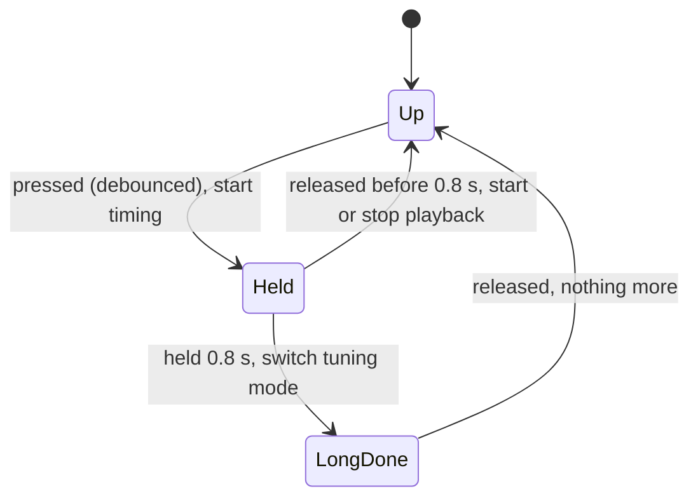

Both buttons start as "held" at power-up, so a button held while switching on has to be let go before it counts.

### The header line

It shows one thing at a time, in this order of priority:

1. a message for 2 s ("REC: no card", "MODE: AUTO", ...), or the classifier's verdict for 5 s ("PIPPIP 87%  9", in yellow; never the faint-sweep group);
2. "PLAY 10x  17s" during playback;
3. "REC   1:23" while recording;
4. "REC saving" while the backlog is written;
5. the LO: "LO:  45.0 kHz" (manual) or "AUTO  43.5kHz".

It's redrawn only when its content changes, because drawing text over SPI is slow. The battery voltage is drawn in the top-right corner once a second.

---

## 13. Start-up

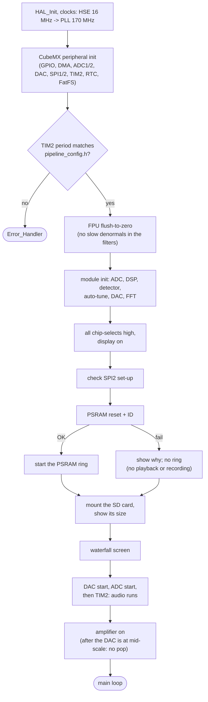

The ring starts before the ADC, so the first audio block is ring block 0. The amplifier is enabled last. Until then the 100k pull-down on `AMP_EN` holds it in standby, so there's no turn-on thump.

## 14. The main loop

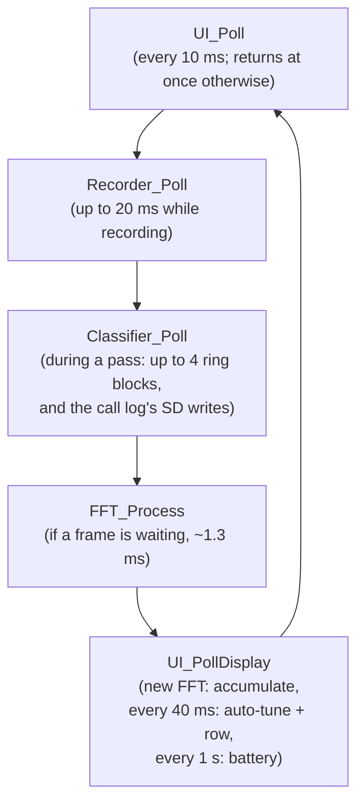

The recorder goes before the FFT on purpose. The ring only holds 16.8 s, so falling behind on the card loses audio. Falling behind on the FFT only skips a frame of the picture. The classifier does nothing while a recording is open, so the two never compete; while it's busy with a pass, the waterfall gets fewer frames.

---

## 15. Interrupts and priorities

Lower number = more urgent. A higher-priority interrupt can preempt a lower one.

| Priority | Interrupt | What it does | How often |
|---|---|---|---|
| **0** | DMA2 Ch1 (SPI1 RX) | PSRAM burst end: raise CE#, start the next burst | ~31,000/s |
| 1 | DMA1 Ch1 (ADC1) | Audio block ready: ring push, DSP, DAC write | 977/s |
| 1 | DMA1 Ch2 (DAC1), TIM6_DAC | DAC DMA and underrun (nothing to do normally) | — |
| 1 | DMA2 Ch2 (SPI1 TX) | Enabled by CubeMX; the ring doesn't use its interrupt | — |
| 3 | DMA1 Ch3 (ADC2) | Knob/battery scan done | 100/s |
| 5 | SPI2 | Enabled by CubeMX; the drivers poll | — |
| 15 | SysTick | `HAL_GetTick` millisecond counter | 1000/s |

The PSRAM interrupt must be alone at 0. `PsramRing_Start()` checks it, because CubeMX gives every newly enabled interrupt priority 0. Masking interrupts (`__disable_irq()`) blocks priority 0 too, so any masked section must be a few dozen instructions at most: a burst has about 3.5 µs of slack.

---

## 16. Memory

### RAM (32 KB)

| What | Bytes | Where |
|---|---|---|
| Recorder slots | 8,192 | `recorder.c` |
| FFT working arrays (re + im) | 4,096 | `fft.c` |
| FFT magnitudes (513 floats) | 2,052 | `fft.c` |
| Stack | 2,048 | linker script |
| ADC buffer (2 × 256 × 2 B) | 1,024 | `adc.c` |
| DAC buffer | 1,024 | `dac.c` |
| Playback slots (2 × 512 B) | 1,024 | `playback.c` |
| PSRAM ring interrupt code (runs from RAM) | ~1,000 | `psram_ring.c` |
| Waterfall row (dB + pixels) | 1,440 | `waterfall.c` |
| FatFS (volume and file objects) | ~600 | FatFS, `recorder.c` |
| Classifier: frames, call track, vote | 2,686 | `classifier_calls.c`, `classifier_species.c` |
| Classifier: ring slots (2 × 512 B) and state | 1,076 | `classifier.c` |
| Call log buffer and file object | 573 | `call_log.c` |
| DSP output block | 512 | `dsp.c` |
| Heap reserve | 512 | linker script |
| Everything else (HAL handles, state, tables) | ~2,300 | |
| **Used** | **29,360 of 32,768 (3.3 KB free)** | |

No `malloc`, and no big buffers on the stack. Every buffer is a fixed static array, so the linker's map file shows exactly where the memory goes.

### Flash (128 KB)

About 80 KB is used: the code plus the constant tables: the FFT window, twiddles, unpack rotation and NCO sine, and the classifier's own smaller set, generated into `Core/DSP/Tables/` by `Tools/gen_dsp_tables.py`. A static assert stops the build if a table doesn't match `AUDIO_FFT_LENGTH`, `LUT_SIZE` or `CLS_FFT_LENGTH`. The classifier is about 15 KB of it, including its species rules.

---

## 17. File map

Reading order: `pipeline_config.h`, then `main.c` (USER CODE parts), `adc.c`, `dsp.c`, `dac.c`. That's the whole live-audio path. Then `ui.c`, and then whichever feature you're interested in.

| File | What it does |
|---|---|
| `Core/Inc/pipeline_config.h` | Sample rate, block size, FFT length, LO range, expansion: the numbers everything else uses |
| `Core/Src/main.c` | CubeMX initialisation, then start-up and the main loop (in the USER CODE blocks) |
| `Core/Src/boot_checks.c` | Power-up checks: SPI2 set-up, PSRAM ID and ring start, SD mount |
| `Core/Src/ui.c` | Buttons, knobs, LEDs, the header line, the battery readout; feeds the waterfall and auto-tune |
| `Core/Src/recorder.c` | WAV recording, ring → SD |
| `Core/Drivers/adc.c` | ADC1 audio DMA (blocks to the DSP), ADC2 knob scan |
| `Core/Drivers/dac.c` | DAC DMA and the half-buffer writer |
| `Core/Drivers/psram.c` | PSRAM reset and ID check at boot |
| `Core/Drivers/psram_ring.c` | The DMA burst engine: 16.8 s of continuous recording, queued reads |
| `Core/DSP/dsp.c` | The per-sample chain: high-pass, mixer, low-passes, volume |
| `Core/DSP/dsp_filters.c` | Butterworth biquad design and processing |
| `Core/DSP/fft.c` | 1024-point real FFT, windowed, magnitudes |
| `Core/DSP/bat_detect.c` | The pulse-rhythm detector |
| `Core/DSP/autotune.c` | Follow the bats with the LO |
| `Core/DSP/playback.c` | Time-expansion playback from the ring |
| `Core/DSP/classifier.c` | The species classifier: reads each bat pass back from the ring, shows the verdict |
| `Core/DSP/classifier_calls.c` | Its stages 1-3: frames, calls, features (no HAL: also built on the PC) |
| `Core/DSP/classifier_species.c` | Its stages 4-6: shape groups, species rules, the vote (no HAL) |
| `Core/DSP/classifier_config.h` | Its constants, mirroring the PC model |
| `Core/Src/call_log.c` | `CALLS.CSV`: a line per reported pass (and per call, if switched on) |
| `Core/DSP/Tables/` | Generated constant tables (don't edit) |
| `Core/Display/waterfall.c` | The scrolling spectrogram |
| `Core/Display/ili9341.c`, `fonts.c` | Display driver (afiskon's, with hardware scroll added) |
| `FATFS/Target/sd_spi.c` | SD card in SPI mode |
| `FATFS/Target/user_diskio.c` | FatFS's glue to `sd_spi.c` |
| `Tools/gen_dsp_tables.py` | Generates `Core/DSP/Tables/` |
| `Tools/check_raw.py` | Checks a recording on the PC: header, and every sample a 12-bit code × 16 |
| `Tools/classify.py`, `species.py` | The classifier's PC model, the reference the C follows |
| `Tools/check_classifier_c.py` | The C classifier against the model: on the PC (gcc), or the board's `CALLS.CSV` against a WAV it recorded |
| `Archive/` | Not built: the debug link, stats, `Diag` library, bench tests, PC capture tools, V1 parts |
| `Docs/engineering_diary.md` | Why things are the way they are: every decision, with numbers |
